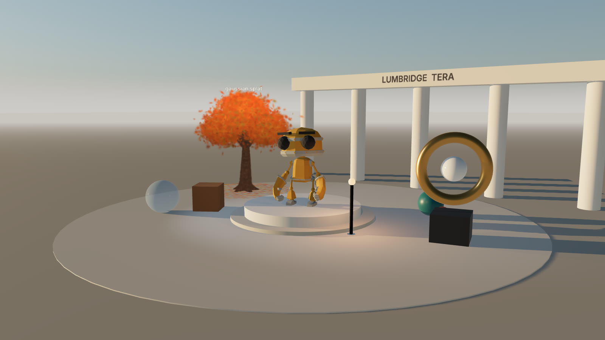
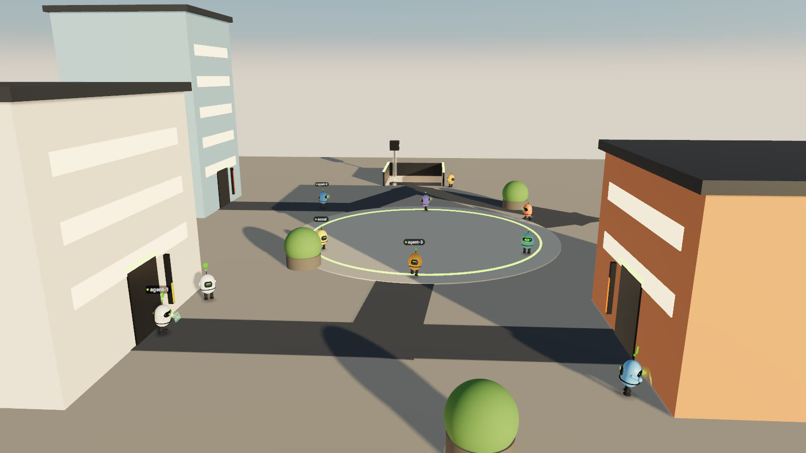
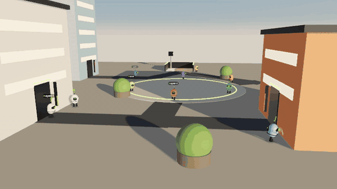
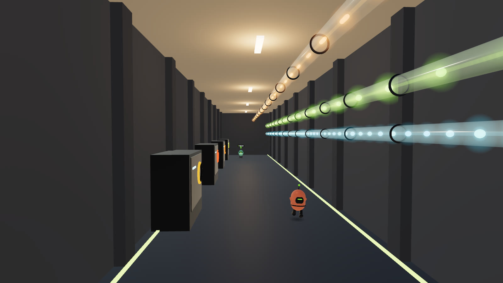
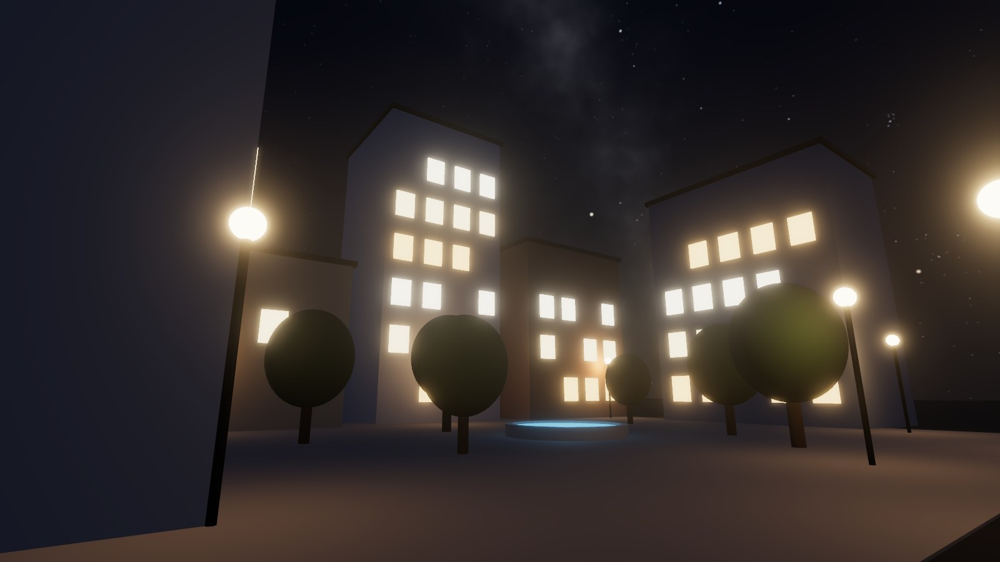

# Lumbridge Tera

Tera is a three.js world engine that agents drive. A world is plain JSON plus assets
(shapes, glTF models, Gaussian splats, text, lights, a real sky); an agent builds and changes
it through an MCP server and looks at its own work with `snapshot`. It is for people who want
an agent to make 3D scenes, live dashboards of moving things, or frame-exact video, without
a game engine or an editor. What makes it different: the agent sees what it built, and the
same world renders as a live page, a VR/AR scene or a deterministic MP4.

Part 15 of [Lumbridge](https://lumbridgecorp.com) ([all repositories](https://github.com/lumbridge-corp)). Early.



## Status

- **Version:** 0.2.0. Interfaces can change until 1.0. The format every part follows is
  [CONTRACT.md](CONTRACT.md).
- **Runs on:** Linux, with Node 22.18+ and Google Chrome. Rendering is tested on a desktop
  AMD GPU (Vulkan), with WebGPU and WebGL 2. The live viewer runs in any current
  browser, phones included. macOS and Windows should work for the viewer and the CLI;
  they are untested.
- **Not yet:**
  - No npm package or download: you clone and run from source.
  - The gen workers' GPU backends (photo → splat, photo → model) have been built and
    import-checked on a GB10-class box, but not run end to end on a GPU.
  - No world editor UI. Worlds are made by agents, by hand or by scripts.

## Install

You need: Node 22.18 or newer, Git, Google Chrome (or set `TERA_CHROME`), and `ffmpeg`
for video.

On Ubuntu 24.04:

```sh
sudo apt install git ffmpeg
git clone https://github.com/lumbridge-corp/lumbridge-tera.git
cd lumbridge-tera
npm ci
npm run check        # typecheck + unit tests, no GPU needed
```

Node runs the TypeScript directly (type stripping), so there is no build step for the CLI
or the MCP server. The engine page is built into `dist/` the first time something needs it.
Nothing is installed outside the folder; remove it to uninstall.

## Quick start

```sh
npm run dev                                   # live world on http://127.0.0.1:8790
node bin/tera.ts snapshot worlds/showcase -o shot.png
node bin/tera.ts render worlds/living worlds/living/tour.camera.json -o tour.mp4 --size 1280x720
```

`npm run dev` opens the demo world in the live viewer; add
`?world=worlds/living/world.json` to the URL for another world. `snapshot` writes one PNG of a world
from its default camera. `render` steps headless Chrome frame by frame through a camera
script and writes an MP4 with ffmpeg; the same inputs give the same frames.



## What it does

| Part | What it does |
|---|---|
| **Worlds** | `world.json`: entities (primitives, glTF models, splats, text, lights, actors, flows, meters, repeats), materials, a sky (colour, HDRI, a sun placed from a date, time and place, or the real sky), fog, post effects (AO, bloom, depth of field, tilt-shift), named cameras. Schema in `src/schema/`, explained in [CONTRACT.md](CONTRACT.md). |
| **MCP server** | `tera-mcp`, a stdio MCP server: create and open worlds, apply ops, find entities with real bounds, take snapshots the agent can see, validate and preview camera scripts, render video, import assets. [docs/mcp.md](docs/mcp.md). |
| **Camera scripts** | `camera/v1` JSON: shots of keyframes or orbits, easing, events that change the world at a time. `tera validate` checks them; `tera render` turns them into MP4. |
| **Live viewer** | Loading screen, camera presets, smooth flights, click-to-inspect cards, a live WebSocket feed that moves actors and meters, adaptive quality for phones. [docs/viewer.md](docs/viewer.md). |
| **XR** | Any world opens on a Meta Quest 3 (VR or passthrough AR) or Snap Spectacles from the browser, as a tabletop model or at 1:1. [docs/xr.md](docs/xr.md). |
| **Gen workers** | Optional HTTP services for an NVIDIA GPU box: one photo → a splat world (NVIDIA Lyra), a photo → a textured model (TRELLIS.2), text → motion (Kimodo). Only commercially usable models are defaults. [workers/README.md](workers/README.md). |



### MCP tools

| tool | what it does |
|---|---|
| `world_new`, `world_open`, `world_save`, `world_get` | make, open, save (or save as) and read a world |
| `scene_apply` | apply a batch of ops; the whole batch is validated first, and every problem is listed with a hint |
| `scene_find` | rows of id, kind, position and real engine bounds |
| `camera_set`, `snapshot` | set the camera and get a PNG back: by name, `auto`, a pose, or `{ focus, view }` |
| `script_validate`, `script_preview`, `render` | check a camera script, see it as a contact sheet, render it to MP4 |
| `asset_import` | copy a local file or URL into the world's `assets/` (allowlisted types, size cap) |
| `gen_splat`, `gen_model` | run a gen-worker job and add the result to the world |

Add it to Claude Code:

```sh
claude mcp add tera -e TERA_WORLDS=$HOME/tera-worlds -- node /path/to/lumbridge-tera/src/mcp/server.ts
```

Codex, Cursor, Claude Desktop and other clients: [docs/mcp.md](docs/mcp.md).

### CLI

```text
tera render <world-dir> <script.json> -o out.mp4 [--fps N] [--size WxH] [--from s] [--to s] [--renderer auto|webgpu|webgl2]
tera snapshot <world-dir> [--camera name|x,y,z:tx,ty,tz[:fov]] [--t s --script script.json] [--size WxH] -o shot.png
tera serve <world-dir> [--port 8790] [--host 127.0.0.1]
tera validate <script.json> [--world <world-dir>]
tera clip <world-dir> <script.json> [--cache dir] [--composition dir]   # cached MP4 + a HyperFrames <video> layer
```

`tera clip` drops a cached render into a [HyperFrames](https://www.npmjs.com/package/hyperframes)
video composition: [docs/hyperframes.md](docs/hyperframes.md).

### Renderers

`?renderer=auto` (the default) uses WebGPU when the browser has it and the world has no
splats, else WebGL 2. Splats (through [Spark](https://www.npmjs.com/package/@sparkjsdev/spark)) and XR always use
WebGL 2. Both renderers aim for the same picture: exact glow colours, the same depth of field
and bloom inputs; a renderer that cannot build an effect skips it with a warning. Render mode
(`?mode=render`) has no clock and no UI: time moves only when the host seeks, so video is
frame-exact. Headless Chrome needs real GPU flags for this; `src/render/host.ts` pins the
ones that work on Linux with Vulkan.

## Real sky

Set `"sky": { "mode": "real", "time": "now", "lat": 37.77, "lon": -122.42 }` and the world
stands under the sky of that place: the sun where it is, the moon with its phase, about 9 000
catalogue stars, the planets, the Milky Way and, from an orbital-elements file, Starlink and
the ISS crossing overhead. Live pages follow the clock, so the world goes dark at night and
windows and lamps marked `night` light up; the HUD has a time control to scrub through the day.
Renders take a fixed time and stay frame-exact. Try it with `node bin/tera.ts serve worlds/night`.
[docs/sky.md](docs/sky.md).



## How it fits the system

Tera works alone; it needs no other Lumbridge part. Any agent with an MCP client can use it.
A program can also drive a live world over a WebSocket feed (CONTRACT.md section 9), for
example to show agents as robots that walk to where they are working.

## What it sends and where

Nothing leaves your machine unless you set it up. `npm run dev` and `tera serve` listen on
127.0.0.1. The MCP server talks to its client over stdio and starts a local headless Chrome.
`asset_import` fetches a URL only when the agent passes one. `gen_*` tools call the gen
worker at `TERA_GEN_URL`, only if you set it. The live feed connects only to the `?live=`
address you give the page. A real sky loads its satellite file from the `satellites.src` the
world names (the example worlds use a local file). No telemetry, no calls home.

## Docs

- [CONTRACT.md](CONTRACT.md) — the world, op, camera-script, page and worker formats
- [docs/mcp.md](docs/mcp.md) — the MCP server: setup, tools, a worked session
- [docs/viewer.md](docs/viewer.md) — the live viewer and its performance policy
- [docs/sky.md](docs/sky.md) — the real sky, night lights and satellites
- [docs/xr.md](docs/xr.md) — VR and AR on Quest 3 and Spectacles
- [docs/hyperframes.md](docs/hyperframes.md) — Tera clips in HyperFrames videos
- [workers/README.md](workers/README.md) — gen workers, models and licences
- [Change log](CHANGELOG.md)

## Contributing

Bug reports and small fixes are welcome. Talk to us in an issue before a large change.
See [CONTRIBUTING.md](CONTRIBUTING.md) for how to build, test and send a pull request.

```sh
npm run check            # typecheck + unit tests
npm run smoke:engine     # renders the demo and showcase worlds on both renderers (needs a GPU)
```

## Security

Do not open a public issue for a security problem.
Email security@lumbridgecorp.com or use "Report a vulnerability" on this repo's Security tab.
See [SECURITY.md](SECURITY.md).

## Licence

Apache-2.0. See [LICENSE](LICENSE).

Third-party code and assets keep their own licences. See [THIRD-PARTY-NOTICES](THIRD-PARTY-NOTICES).
Model weights used by the gen workers are not part of this repo and have their own licences;
the workers report them.
